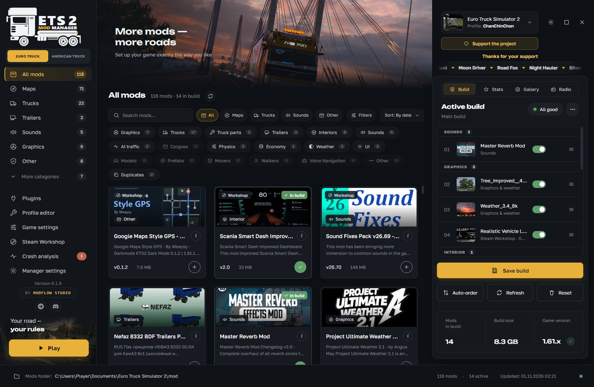
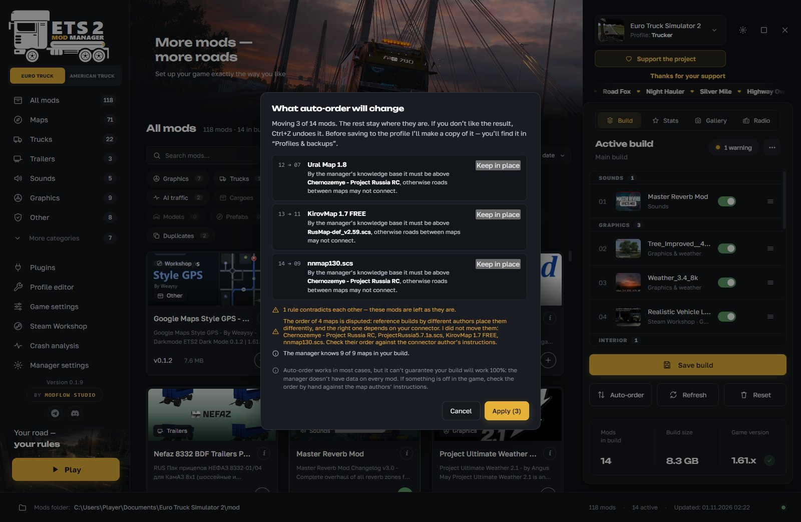
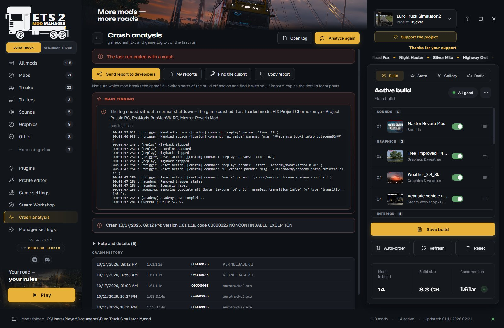
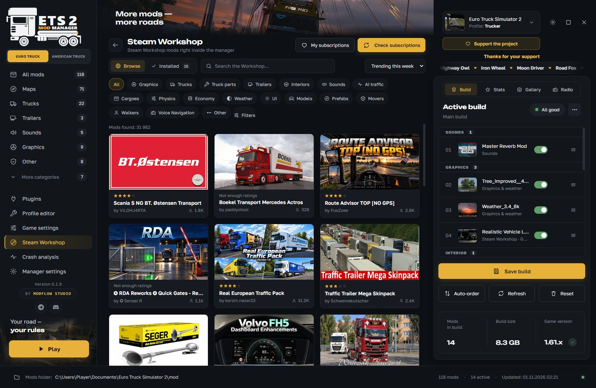
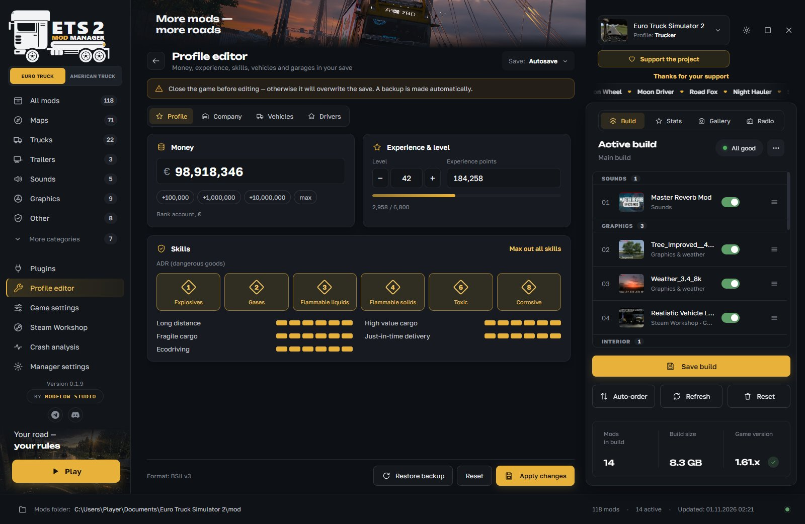

# ETS|ATS Mod Manager

**A mod manager for Euro Truck Simulator 2 and American Truck Simulator**

Free · Windows 10 and 11 · 16 interface languages

### [Download the latest version](https://github.com/ModFlowStudio/ets-ats-mod-manager/releases/latest)

[Русский](README.md) · [Telegram](https://t.me/ModFlowStudio) · [Discord](https://discord.gg/3wq4sZv55w) · [Support the project](https://donatepay.ru/don/ModFlowStudio)

---

Build your own set from folder and Steam Workshop mods, put them in the right order and find out in plain words why the game crashed. All in one window, and all features are free.

  

## What the manager does

**Mods and builds**
- All mods in one window: from the `mod` folder and from Steam Workshop. Categories, tags, search, pictures and descriptions.
- Install by dragging: drop a `.scs`, a `.zip` or a mod folder into the window and the manager puts the files in place.
- Several builds with quick switching. You can share a build as a `.tmod` file or as an archive together with the mods.
- The manager warns you if a mod is not for your game version, a DLC is missing or mod files are duplicated.
- The mod list refreshes by itself when you add a mod to the folder or remove one.

**Auto-order**
- One button puts the mods in order. Before applying, you see what moves and why. You can leave any mod where it is and undo the result with Ctrl+Z.
- The manager takes into account the order of popular maps, mod contents and how other players most often arrange mods.
- It is a hint, not a guarantee: we do not promise a 100% working build.

**Crash analysis**
- Reads the game logs and explains in plain words what broke: a mod, a plugin, a driver or low memory.
- “Find the culprit” turns parts of the build off one by one. You can also start the game without mods.
- A report goes to the developers straight from the program, and the reply comes back into the manager.

**Profile and game**
- Profile editor: money, experience, skills, ADR, repair and refuel, cities and garages. A save backup is made before editing.
- Game settings: optimization, buffer size, launch options, clearing the cache and logs.
- Game plugins, radio, profile statistics, a screenshot gallery.
- A 3D viewer for trucks and trailers (trial version).

**Two games in one program**
- Euro Truck Simulator 2 and American Truck Simulator switch with one button, and each game has its own mods, profiles and builds.
- ATS support is still in development and may be unstable.

## Screenshots

<table>
  <tr>
    <td width="50%"> <b>Auto-order.</b> Before applying, you see what moves and why.</td>
    <td width="50%"> <b>Crash analysis.</b> The main finding is on top, suspicious mods turn off with one button.</td>
  </tr>
  <tr>
    <td width="50%"> <b>Steam Workshop</b> inside the manager: search, categories, subscriptions.</td>
    <td width="50%"> <b>Profile editor.</b> A save backup is made before editing.</td>
  </tr>
</table>

## How to install

1. Open the [latest release](https://github.com/ModFlowStudio/ets-ats-mod-manager/releases/latest) and download the `ETS-ATS-Mod-Manager-Setup-….exe` installer (about 90 MB) from the **Assets** section.
2. Run it. If Windows shows a warning, click “More info”, then “Run anyway”. The program does not have a paid publisher signature yet, so Windows shows this warning for any unsigned program.
3. On the first launch, read the user agreement and press “Accept”.
4. The manager finds the game and profiles by itself. After that it updates with the “Update!” button inside the program.

There is no portable version, only the installer. You need Windows 10 or 11 and Euro Truck Simulator 2 and/or American Truck Simulator.

## FAQ

**Windows warns about the installer. Is it a virus?**
No. The warning appears because the program does not have a paid publisher signature. Click “More info” and “Run anyway”. You can scan the installer on VirusTotal.

**Does auto-order guarantee that mods will work?**
No. It takes into account guides, mod contents and the experience of other players, but it cannot know everything. That is why it shows what moves and why before applying.

**The game crashes. What should I do?**
Open “Crash analysis”: the manager explains what broke and shows suspicious mods. If the cause is unclear, start the game without mods (build menu “⋯”) and use “Find the culprit”.

**Which mods are supported?**
`.scs` and `.zip` files and mod folders with `manifest.sii`. `.rar` archives are not supported.

**Do I need Steam?**
The manager works with mods from the game folder. Steam Workshop needs Steam with the game purchased.

**What data do you collect?**
We do not collect personal data (name, email, passwords, contents of personal files, Steam logins). To improve the manager, anonymous statistics are sent: versions, names of installed mods and their order, which features are used, error information. You can turn it off in the manager settings. Details are in the user agreement, which is shown on the first launch and available in “Manager settings” → “About”. Note that the agreement is shown in English for non-Russian interface languages.

## What's new

The changes of every version are on the [Releases](https://github.com/ModFlowStudio/ets-ats-mod-manager/releases) page. The manager shows the same text when it updates.

## License

The source code is closed, and this repository holds only the ready-made installers. All rights belong to ModFlow Studio.

The program is free for personal use. You may pass it to others only as the unchanged installer with a link to this page. Without written permission from the authors you may not sell the program, present it as your own, take it apart, modify it or publish modified copies. The terms for passing the program on are also in the user agreement.

## Studio and contacts

The manager is made by **ModFlow Studio** (Quaaazi and Underworld). We post update news, developer replies and help with mods in our channels:

- Telegram: [t.me/ModFlowStudio](https://t.me/ModFlowStudio)
- Discord: [discord.gg/3wq4sZv55w](https://discord.gg/3wq4sZv55w)
- You can report a problem from the program: “Crash analysis” → “Send report to developers”.
- Support the project: [DonatePay](https://donatepay.ru/don/ModFlowStudio). Thank you to everyone who already did.

---

ETS|ATS Mod Manager is not affiliated with SCS Software, Valve (Steam), TruckersMP or the authors of maps and mods. Names of games, mods and services belong to their owners. © ModFlow Studio. All rights reserved.
