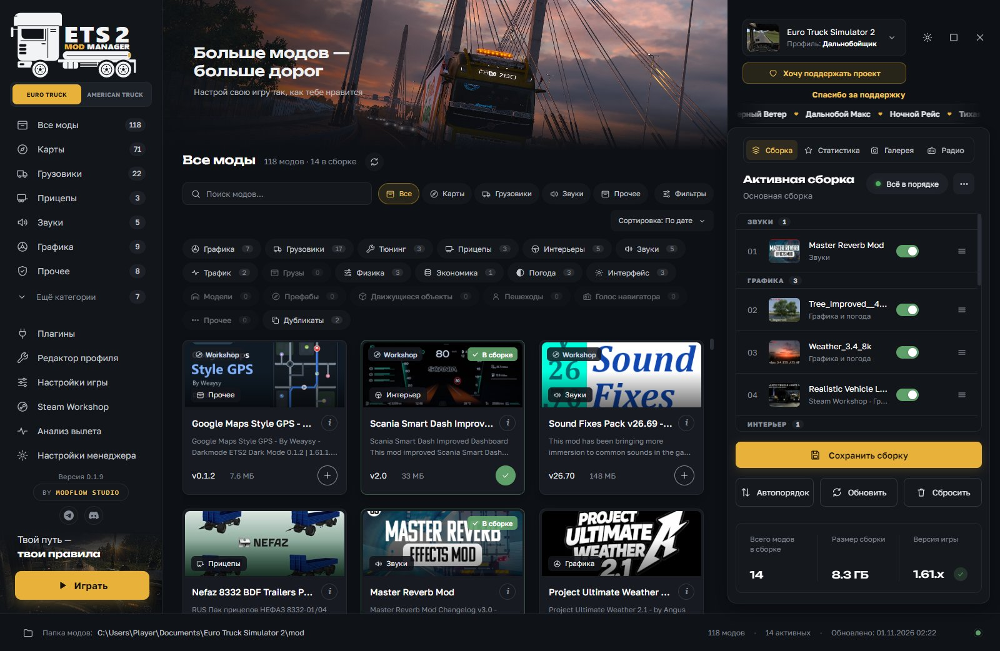
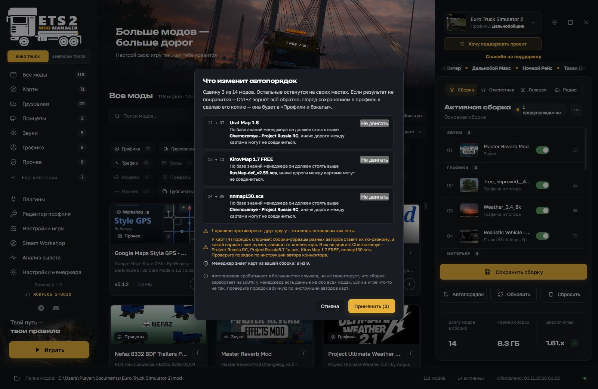
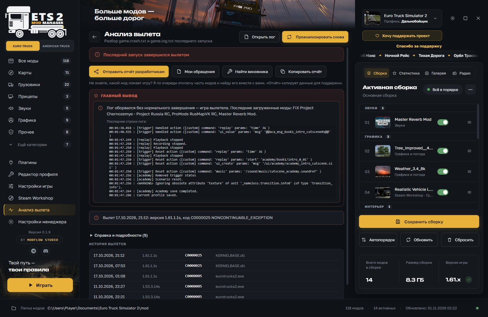
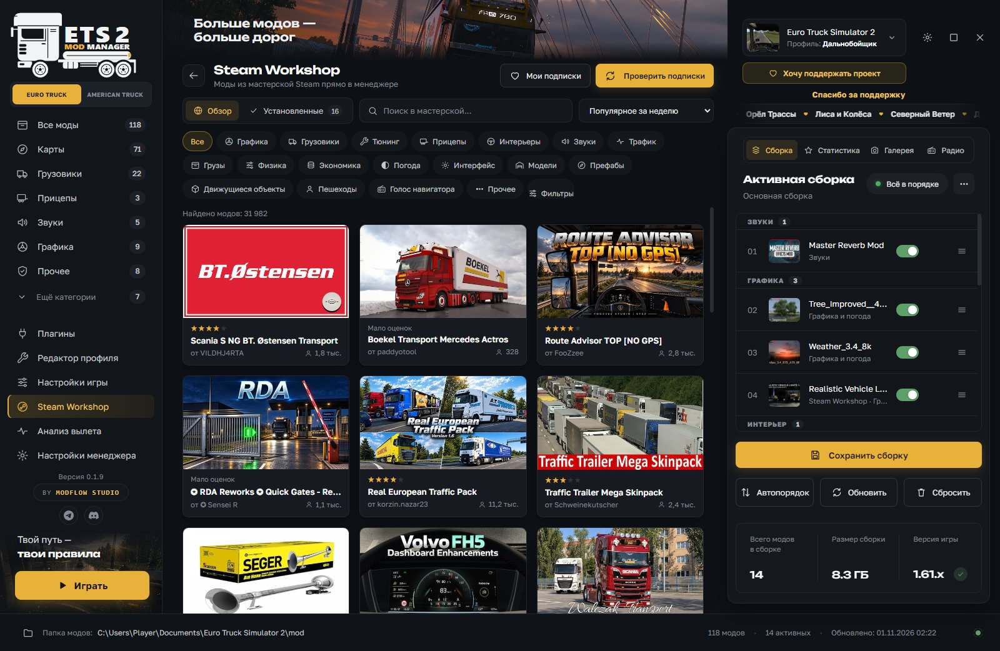
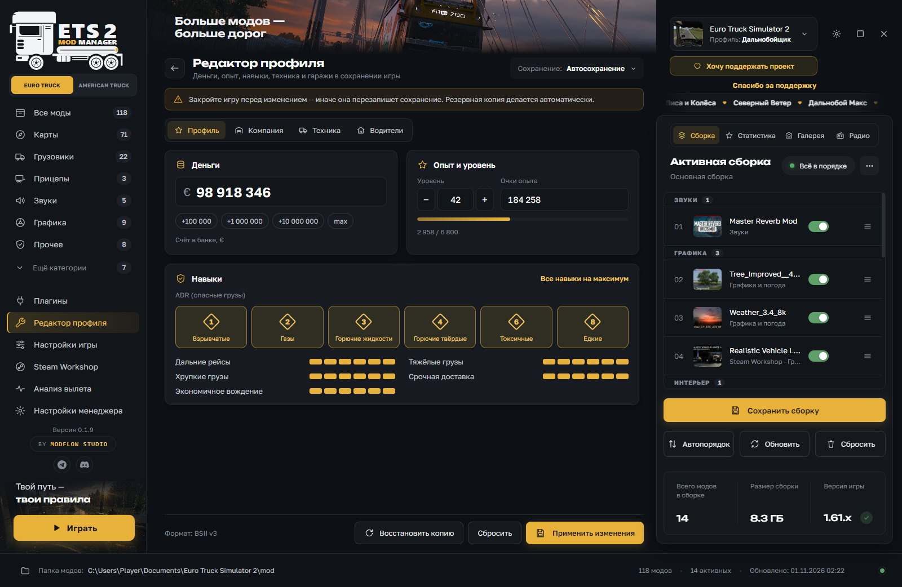

# ETS|ATS Mod Manager

**Менеджер модов для Euro Truck Simulator 2 и American Truck Simulator**

Бесплатно · Windows 10 и 11 · 16 языков интерфейса

### [Скачать последнюю версию](https://github.com/Quaaazi/ets2-mod-manager/releases/latest)

[English](README.en.md) · [Telegram](https://t.me/ModFlowStudio) · [Discord](https://discord.gg/3wq4sZv55w) · [Поддержать проект](https://donatepay.ru/don/quaaazi)

---

Соберите свою сборку из модов папки и Steam Workshop, расставьте их в нужном порядке и узнайте простыми словами, из-за чего упала игра. Всё в одном окне, все функции бесплатны.

  

## Что умеет менеджер

**Моды и сборки**
- Все моды в одном окне: из папки `mod` и из Steam Workshop. Категории, теги, поиск, картинки и описания.
- Установка перетаскиванием: бросьте в окно `.scs`, `.zip` или папку с модом, менеджер разложит файлы сам.
- Несколько сборок с быстрым переключением. Сборкой можно поделиться файлом `.tmod` или архивом вместе с модами.
- Менеджер предупредит, если мод не для вашей версии игры, не хватает DLC или файлы модов дублируются.
- Список модов обновляется сам, когда вы кладёте мод в папку или убираете его.

**Автопорядок**
- Одна кнопка расставляет моды. Перед применением видно, что и почему сдвинется, любой мод можно оставить на месте, а результат отменить через Ctrl+Z.
- Менеджер учитывает порядок популярных карт, содержимое модов и то, как моды чаще всего расставляют другие игроки.
- Это подсказка, а не гарантия: на 100% работу сборки мы не обещаем.

**Анализ вылета**
- Читает логи игры и объясняет простыми словами, что сломалось: мод, плагин, драйвер или нехватка памяти.
- «Найти виновника» по очереди отключает части сборки. Можно запустить игру без модов.
- Отчёт отправляется разработчикам прямо из программы, ответ приходит обратно в менеджер.

**Профиль и игра**
- Редактор профиля: деньги, опыт, навыки, ADR, ремонт и заправка, города и гаражи. Перед правкой делается копия сохранения.
- Настройки игры: оптимизация, размер буфера, параметры запуска, очистка кэша и логов.
- Плагины игры, радио, статистика профиля, галерея скриншотов.
- 3D-осмотр грузовиков и прицепов (пробная версия).

**Две игры в одной программе**
- Euro Truck Simulator 2 и American Truck Simulator переключаются одной кнопкой, у каждой игры свои моды, профили и сборки.
- Поддержка ATS пока в разработке и может работать нестабильно.

## Скриншоты

<table>
  <tr>
    <td width="50%"> <b>Автопорядок.</b> Перед применением видно, что и почему сдвинется.</td>
    <td width="50%"> <b>Анализ вылета.</b> Главный вывод наверху, подозрительные моды отключаются одной кнопкой.</td>
  </tr>
  <tr>
    <td width="50%"> <b>Steam Workshop</b> внутри менеджера: поиск, категории, подписки.</td>
    <td width="50%"> <b>Редактор профиля.</b> Перед правкой делается копия сохранения.</td>
  </tr>
</table>

## Как установить

1. Откройте [последнюю версию](https://github.com/Quaaazi/ets2-mod-manager/releases/latest) и скачайте установщик `ETS-ATS-Mod-Manager-Setup-….exe` (около 90 МБ) из раздела **Assets**.
2. Запустите его. Если Windows показывает предупреждение, нажмите «Подробнее», затем «Выполнить в любом случае». У программы пока нет платной подписи издателя, поэтому предупреждение появляется у любой неподписанной программы.
3. При первом запуске прочитайте пользовательское соглашение и нажмите «Принять».
4. Менеджер сам найдёт игру и профили. Дальше он обновляется кнопкой «Обновить!» прямо в программе.

Портативной версии нет, только установщик. Нужна Windows 10 или 11 и Euro Truck Simulator 2 и/или American Truck Simulator.

## Частые вопросы

**Windows ругается на установщик. Это вирус?**
Нет. Предупреждение появляется потому, что у программы нет платной подписи издателя. Нажмите «Подробнее» и «Выполнить в любом случае». Установщик можно проверить на VirusTotal.

**Автопорядок гарантирует, что моды заработают?**
Нет. Он учитывает гайды, содержимое модов и опыт других игроков, но знать всё не может. Поэтому перед применением он показывает, что и почему сдвинется.

**Игра вылетает. Что делать?**
Откройте «Анализ вылета»: менеджер объяснит, что сломалось, и покажет подозрительные моды. Если причина не ясна, запустите игру без модов (меню сборки «⋯») и используйте «Найти виновника».

**Какие моды поддерживаются?**
Файлы `.scs`, `.zip` и моды-папки с `manifest.sii`. Архивы `.rar` не поддерживаются.

**Нужен ли Steam?**
Менеджер работает с модами из папки игры. Для Steam Workshop нужен Steam с купленной игрой.

**Какие данные вы собираете?**
Личных данных (имя, почта, пароли, содержимое личных файлов, логины Steam) мы не собираем. Для улучшения менеджера отправляется обезличенная статистика: версии, названия установленных модов и их порядок, какими функциями пользуются, сведения об ошибках. Её можно отключить в настройках менеджера. Подробности в пользовательском соглашении, которое показывается при первом запуске и доступно в «Настройки менеджера» → «О программе».

## Что нового

Список изменений каждой версии лежит на странице [Releases](https://github.com/Quaaazi/ets2-mod-manager/releases). Тот же текст менеджер показывает при обновлении.

## Лицензия

Исходный код программы закрыт, в этом репозитории лежат только готовые установщики. Все права принадлежат ModFlow Studio.

Программа бесплатна для личного использования. Передавать её другим можно только установщиком без изменений и со ссылкой на эту страницу. Продавать программу, выдавать её за свою, разбирать на части, менять и выкладывать изменённые копии нельзя без письменного разрешения авторов. Условия передачи программы описаны и в пользовательском соглашении.

## Студия и связь

Менеджер делает **ModFlow Studio** (Quaaazi и Underworld). Новости обновлений, ответы разработчиков и помощь по модам мы публикуем в наших каналах:

- Telegram: [t.me/ModFlowStudio](https://t.me/ModFlowStudio)
- Discord: [discord.gg/3wq4sZv55w](https://discord.gg/3wq4sZv55w)
- Об ошибке можно сообщить прямо из программы: «Анализ вылета» → «Отправить отчёт разработчикам».
- Поддержать проект: [DonatePay](https://donatepay.ru/don/quaaazi). Спасибо всем, кто уже поддержал.

---

ETS|ATS Mod Manager не связан с SCS Software, Valve (Steam), TruckersMP, авторами карт и модов. Названия игр, модов и сервисов принадлежат их владельцам. © ModFlow Studio. Все права защищены.
